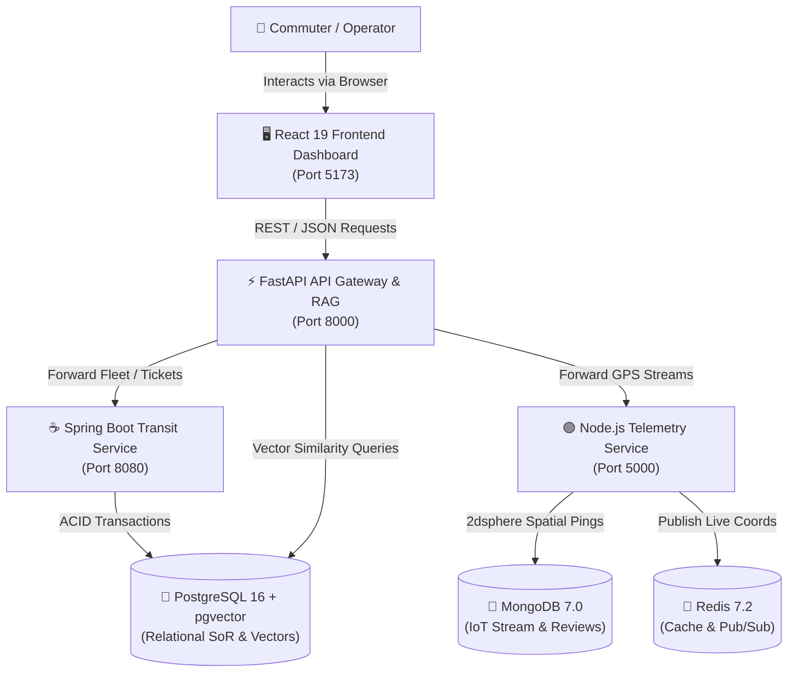
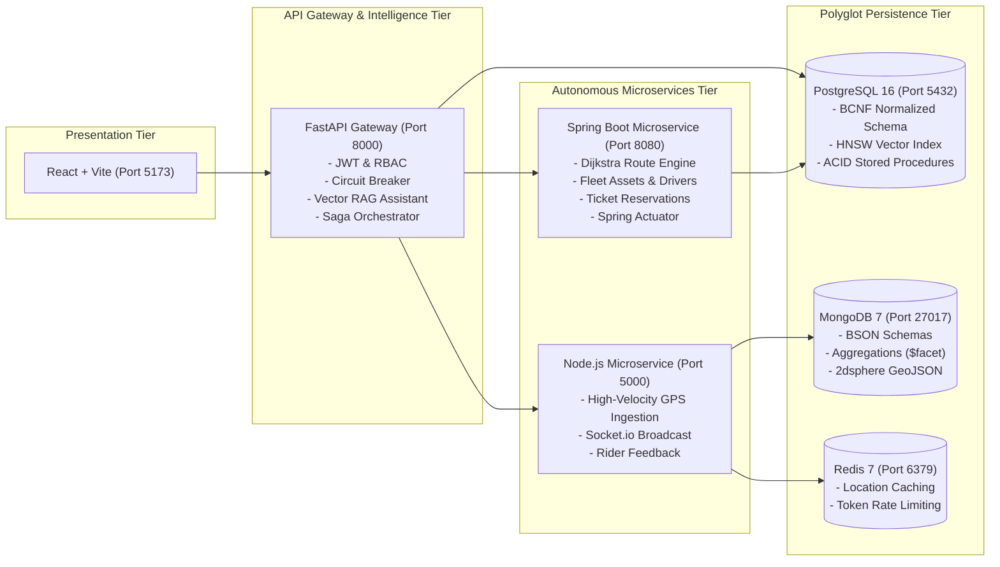

# 🚍 Urban Mobility Data Integration & Route Intelligence Platform

[](https://github.com/urban-mobility/platform/actions)
[](docker-compose.yml)
[](k8s/)
[](database/)
[](database/mongo/)
[](backend-fastapi/)
[](backend/)
[](backend-node/)
[](frontend/)

A polyglot, enterprise-grade Urban Mobility Data Integration and Route Intelligence Platform engineered to satisfy **all Course Outcomes from CO1 through CO6** in advanced Database Engineering, Backend API Design, Microservices, and Cloud-Native Delivery.

---

## 📑 Syllabus Traceability Matrix (CO1 - CO6)

For the complete, topic-by-topic academic mapping, see [**SYLLABUS_MAPPING.md**](SYLLABUS_MAPPING.md).

- **CO1: Relational Database Engineering**: ANSI/PostgreSQL DDL schema, 3-schema ANSI/SPARC architecture, ER modeling (1:1, 1:N, N:M), normalisation proofs (UNF -> 1NF -> 2NF -> 3NF -> BCNF), advanced SQL joins, recursive CTE graph reachability, window functions (`ROW_NUMBER`, `RANK`, `LAG`, `LEAD`, moving averages), ACID transaction procedures with row locking (`SELECT FOR UPDATE`), triggers, and views.
- **CO2: Database Engineering**: SQL vs NoSQL comparative study (CAP theorem & PACELC), MongoDB document engineering with BSON validators, aggregation pipelines (`$match`, `$group`, `$project`, `$unwind`, `$facet`), 2dsphere geospatial indexing, Transactional Outbox polyglot synchronization, high-dimensional vector embeddings, pgvector HNSW ANN indexing, hybrid search, and RAG knowledge assistant.
- **CO3: Backend API Engineering — FastAPI**: RESTful architectural constraints, Pydantic v2 schemas, modular APIRouter, dependency injection (`Depends`), async ASGI concurrency, JWT authentication, RBAC authorization guards, rate limiting, and comparative study on Flask vs Django DRF.
- **CO4: Multi-Framework Backend Engineering**:
  - **Node.js / Express**: Event loop, middleware pipeline, Joi validation, Mongoose ODM, Sequelize ORM, Socket.io real-time GPS stream, Redis caching.
  - **Spring Boot 3.5**: IoC, JPA/Hibernate, Spring Security 6, Spring Boot Actuator metrics, SpringDoc OpenAPI Swagger UI, `@Async` background tasks.
  - **.NET 8 Core (Self-Learning)**: ASP.NET Core Web API, EF Core DbContext, JWT Bearer, and Swagger Swashbuckle reference implementation.
- **CO5: Microservices Engineering**: Domain-driven decomposition (Transit/Fleet, Telemetry/Activity, AI Knowledge), Database-per-Service pattern, FastAPI API Gateway with reverse proxy routing, token header forwarding (`X-User-Id`, `X-User-Role`, `X-Correlation-ID`), circuit breaker resilience, 2PC vs Saga comparison, and **Distributed Saga Orchestrator** with automated compensating rollback.
- **CO6: Deployment, Observability & Delivery**: Multi-stage Dockerfiles, master `docker-compose.yml`, Kubernetes manifests (`k8s/` with Ingress and HPA), Prometheus metrics scraping, Grafana dashboards, GitHub Actions CI/CD pipeline, OWASP API Security Top 10 compliance audit, Locust and k6 load testing scripts.

---

## 🏛️ System Architecture (C4 Model)

### C4 Level 1: System Context Diagram


### C4 Level 2: Container Diagram


---

## 🚀 Quick Start Guide

### Option 1: Immediate Run (FastAPI Engine & React Frontend)
Zero external dependencies required! The Python backend contains an auto-adapting runner that runs out of the box with standard Python 3.

```bash
# 1. Start the Backend Engine (Terminal 1)
python3 backend-fastapi/run_server.py
# Backend active on: http://localhost:8000
# Interactive API Documentation: http://localhost:8000/docs

# 2. Start the Frontend Dashboard (Terminal 2)
cd frontend
npm install
npm run dev
# Open in browser: http://localhost:5173
```

### Option 2: Run Spring Boot Microservice
```bash
cd backend
# Run with PostgreSQL (default)
mvn spring-boot:run

# Or run with zero local database setup using in-memory H2 profile:
mvn spring-boot:run -Dspring-boot.run.profiles=h2
# Spring Boot active on: http://localhost:8080
# Swagger UI: http://localhost:8080/swagger-ui.html
# Actuator Health: http://localhost:8080/actuator/health
```

### Option 3: Run Node.js Telemetry Microservice
```bash
cd backend-node
npm install
npm start
# Active on: http://localhost:5000
# Prometheus Metrics: http://localhost:5000/metrics
```

### Option 4: Full Cloud-Native Docker Compose Stack
Orchestrates PostgreSQL with pgvector, MongoDB, Redis, FastAPI Gateway, Spring Boot, Node.js, React Frontend, Prometheus, and Grafana in a single command:
```bash
docker compose up --build
```

### Option 5: Deploy to Kubernetes Cluster
```bash
kubectl apply -f k8s/00-namespace.yaml
kubectl apply -f k8s/
```

---

## 🔑 Default Credentials & Demo Accounts

| Role | Email | Password | Access Privileges |
| :--- | :--- | :--- | :--- |
| **System Administrator** | `admin@mobility.com` | `admin123` | Full access to route modifications, vehicle fleet dispatch, and admin endpoints. |
| **City Commuter** | `user@mobility.com` | `user123` | Route calculations, RAG assistant queries, ticket reservations, and feedback. |

---

## 🔌 API Endpoints Reference

| HTTP Method | Endpoint | Description | Service / CO |
| :--- | :--- | :--- | :--- |
| `POST` | `/api/auth/login` | Authenticate with credentials and issue signed JWT token | FastAPI / Spring (CO3) |
| `POST` | `/api/auth/register` | Register new commuter account | FastAPI / Spring (CO3) |
| `GET` | `/api/routes` | List all transit routes and waypoints | All (CO1, CO3) |
| `POST` | `/api/routes` | Create new transit route (Admin only, RBAC) | FastAPI / Spring (CO1, CO3) |
| `POST` | `/api/routes/calculate` | Dijkstra shortest path with dynamic traffic penalties | FastAPI / Spring (CO1, CO3) |
| `GET` | `/api/vehicles` | List fleet vehicles, batteries, and assigned drivers | All (CO1, CO3) |
| `GET` | `/api/traffic` | List real-time corridor congestion reports | All (CO1, CO3) |
| `POST` | `/api/ingestion/mobility` | Ingest IoT GPS sensor coordinates with anomaly detection | All (CO3, CO4) |
| `POST` | `/api/rag/ask` | AI Transit Knowledge Assistant (pgvector semantic search) | FastAPI / Spring (CO2, CO3) |
| `GET` | `/api/rag/documents` | Inspect indexed knowledge policy chunks and vectors | FastAPI / Spring (CO2) |
| `POST` | `/api/trips/saga/book` | Execute Distributed Saga Booking Transaction | FastAPI (CO5) |
| `POST` | `/api/trips/saga/simulate-failure` | Simulate Saga Failure & Automatic Compensating Rollback | FastAPI (CO5) |
| `GET` | `/api/v1/gateway/status` | Inspect API Gateway registry and Circuit Breaker state | FastAPI (CO5) |
| `GET` | `/actuator/health` | Spring Boot health and readiness probes | Spring Boot (CO4, CO6) |
| `GET` | `/metrics` | Prometheus metrics endpoint | Node / Spring / FastAPI (CO6) |

---

## 🐙 How to Push and Upload to Your GitHub

Follow these exact commands to push the entire project to your personal GitHub repository:

```bash
# 1. Initialize git repository (if not already done)
git init

# 2. Add all project files (cleanly filtered by .gitignore)
git add .

# 3. Create initial commit
git commit -m "feat: complete polyglot urban mobility platform (CO1 to CO6)"

# 4. Set main branch
git branch -M main

# 5. Connect to your GitHub repository (replace with your repo URL)
git remote add origin https://github.com/<YOUR_GITHUB_USERNAME>/<YOUR_REPOSITORY_NAME>.git

# 6. Push to GitHub
git push -u origin main
```

---

## 📁 Repository Directory Structure

```
urban-mobility-platform/
├── .github/workflows/ci.yml       # GitHub Actions CI/CD & Security Pipeline (CO6)
├── backend-fastapi/               # FastAPI API Gateway, RAG & Saga Engine (CO3, CO5)
│   ├── app/
│   │   ├── api/v1/endpoints/      # Modular REST endpoints (auth, routes, trips, rag, gateway)
│   │   ├── core/                  # Security (JWT, bcrypt), config, dependencies (RBAC)
│   │   ├── repositories/          # Layered data store & abstractions
│   │   ├── schemas/               # Pydantic v2 schemas
│   │   └── services/              # Dijkstra engine, 128-dim vectors, RAG, Saga orchestrator
│   ├── docs/                      # Flask vs Django DRF comparative study (CO3)
│   ├── Dockerfile
│   ├── requirements.txt
│   └── run_server.py              # Zero-dependency standalone server runner
├── backend/                       # Spring Boot 3.5 Transit & Fleet Microservice (CO4, CO5)
│   ├── src/main/java/com/urbanmobility/
│   │   ├── config/                # DataSeeder & RagDataSeeder
│   │   ├── controller/            # REST controllers (Route, Vehicle, Traffic, Trip, RAG)
│   │   ├── model/                 # JPA Entities (User, Route, Stop, Vehicle, DocumentChunk)
│   │   ├── repo/                  # Spring Data JPA Repositories
│   │   ├── security/              # Spring Security 6 & JwtFilter
│   │   └── service/               # RouteEngine, RagService, VectorStoreService
│   ├── src/main/resources/        # application.properties & application-h2.properties
│   ├── Dockerfile
│   └── pom.xml                    # Maven configuration (Actuator, JPA, PostgreSQL, H2)
├── backend-node/                  # Node.js Express Telemetry & Socket.io Microservice (CO4, CO5)
│   ├── server.js                  # Express, Socket.io broadcast, REST endpoints, metrics
│   ├── package.json
│   └── Dockerfile
├── backend-dotnet/                # ASP.NET Core 8 Web API Reference & Study (CO4)
│   ├── Program.cs                 # EF Core, JWT, Swagger setup
│   ├── UrbanMobility.API.csproj
│   └── DOTNET_COMPARATIVE_STUDY.md
├── database/                      # Relational Database & Vector Scripts (CO1, CO2)
│   ├── schema-ddl.sql             # ANSI/PostgreSQL DDL schema with constraints & indexes
│   ├── schema-normalisation.sql   # Normalisation study (UNF -> 1NF -> 2NF -> 3NF -> BCNF)
│   ├── advanced-queries.sql       # Recursive CTEs, Joins, Window functions, Aggregations
│   ├── stored-procedures-triggers.sql # ACID procedures, triggers, views, MVCC, isolation tests
│   ├── pgvector.sql               # Vector embeddings, HNSW index, hybrid search
│   ├── polyglot-sync.py           # Outbox pattern dual-database synchronizer
│   ├── comparative-study.md       # SQL vs NoSQL comparative study (CAP theorem)
│   └── mongo/                     # MongoDB document schemas, aggregations, 2dsphere geo
├── frontend/                      # React 19 + Vite Dashboard
│   ├── src/main.jsx               # Dashboard with Dijkstra, RAG AI Assistant, Saga UI
│   ├── src/style.css
│   ├── Dockerfile
│   └── package.json
├── k8s/                           # Production Kubernetes Manifests (CO6)
│   ├── 00-namespace.yaml
│   ├── 01-configmaps-secrets.yaml
│   ├── 02-databases.yaml          # Postgres PVC, Mongo, Redis
│   ├── 03-backend-services.yaml   # FastAPI, Spring Boot, Node Deployments & Services
│   ├── 04-frontend.yaml
│   ├── 05-ingress.yaml            # Ingress routing rules
│   └── 06-hpa.yaml                # Horizontal Pod Autoscaling
├── monitoring/                    # Observability Tier (CO6)
│   ├── prometheus.yml             # Multi-service metrics scraper
│   └── grafana-dashboard.json     # Provisioned Grafana dashboard
├── postman/                       # API Testing & Demonstration (CO1-CO6)
│   └── urban-mobility-api-collection.json # Official Postman collection v2.1
├── tests/load/                    # Load Testing & Benchmarks (CO6)
│   ├── locustfile.py              # Locust user traffic simulation
│   └── k6-test.js                 # k6 threshold & performance testing
├── docker-compose.yml             # Master Docker Compose specification (CO6)
├── SYLLABUS_MAPPING.md            # Traceability matrix for college course outcomes
├── DEMO_PRESENTATION_GUIDE.md     # 10-minute presentation guide for viva evaluation
└── README.md
```

---

## 👥 Authors & Academic Context
Urban Mobility Data Integration & Route Intelligence Platform  
*Comprehensive Computer Science & Database Engineering Capstone (CO1 - CO6).*
